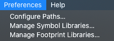
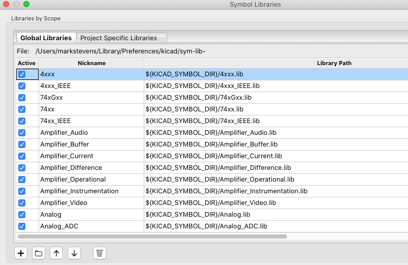

# KiCad Libraries

## Using the Symbol and Footprint

### Download the files in the _WildernessLabs_ directory to you local machine

The _WildernessLabs_ directory contains the schematic, footprint and 3D KiCad parts.

### Add a reference to the Library

The two libraries (schematic and footprint) need to be added separately.  The preferences holds two menu items for managing these libraries:

Select either _Manage Symbol Libraries..._ or _Manage Footprint Libraries..._.

Assuming _Manage Symbol Libraries..._ was selected, a list of the known libraries will be presented in a dialog box:

The libraries can be installed either as a Global or a Project library.

Global libraries are available to all projects developed using KiCad.  Project libraries are only available for the current project.

A library can be added by clicking on the folder icon:

Browse to the folder containing the symbol or footprint, select the file or directory and select Open.

The symbols / footprints should now be available to the project.
